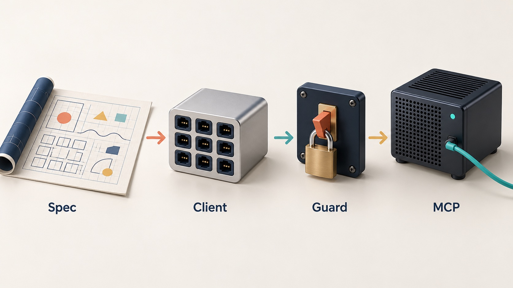
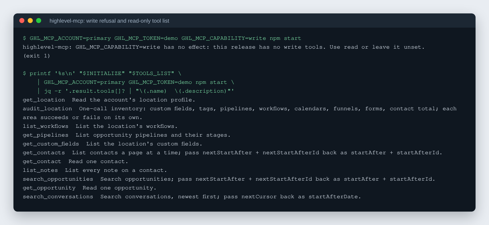

# connectors

A typed GoHighLevel API client and a read-only MCP server, built from GoHighLevel's published OpenAPI files.

[](https://github.com/rodaddy/connectors/actions/workflows/ci.yml)
[](LICENSE)


## What it is

A TypeScript npm workspace of business API connectors, one package per
service. Today it holds one connector, GoHighLevel (GHL), plus a read-only MCP
server on top of it. It is for developers and agencies who build on GHL: CRM
syncs, reporting, automations, or an AI assistant that answers questions about
contacts and pipelines.

| Package                                                        | What it is                                                   |
| -------------------------------------------------------------- | ------------------------------------------------------------ |
| `packages/highlevel` (`@rodaddy/connectors-highlevel`)         | A GoHighLevel API client                                     |
| `packages/highlevel-mcp` (`@rodaddy/connectors-highlevel-mcp`) | A stdio MCP server exposing allowlisted, read-only GHL tools |

## Why it exists

Several of the author's apps talked to GoHighLevel, each with its own partial
client and its own copy of the same lessons: GHL's Cloudflare front rejects
the default `User-Agent`, one sub-account's token must never touch another
sub-account, and writes need a deliberate switch. This repo is the one place
those lessons live ([docs/decisions.md](docs/decisions.md)). It is published
as a reference for anyone building on the GHL API.

## How it works



Generator scripts in `packages/highlevel/scripts/` read GoHighLevel's
CC0-licensed OpenAPI and webhook files, pinned to one upstream commit, and
write a catalog of every REST operation and typed webhook event names.
`callOperation` resolves any operation from that catalog by `operationId` or
path template, fills path and query parameters, and sends it through the
client. `createClient` binds a client to one account: it refuses a request that
names another account's location before `fetch` runs, and it sends writes only
when built with `allowWrites: true`. Typed helpers (contacts, opportunities,
pipelines, notes, conversations and more) sit on top of `callOperation`. The
MCP server wraps a read-only allowlist of those helpers as tools for an AI
client over stdio.



_Real output: the MCP server started with a placeholder token, which is enough
for its boot check and `tools/list`; neither calls GoHighLevel._

## Features

- **Every official endpoint.** The GHL v2/v3 REST API with a Private
  Integration token, through a catalog generated from GHL's published OpenAPI
  files. Typed helpers cover contacts, opportunities, pipelines, notes, tags,
  tasks, custom fields, conversations, workflows, emails, locations and phone
  numbers.
- **Account guard.** A client is built for one account and refuses any request
  that names another known account's location, in the path, query or body.
- **Writes are opt-in.** A client sends writes only when built with
  `allowWrites: true`; a `dryRun` client plans the request instead of sending
  it.
- **Webhooks.** Signature verification, a replay store, and typed event names
  generated from the published webhook schemas.
- Retries with backoff, typed errors, and an OAuth helper with a pluggable
  token store.
- **Read-only MCP server.** Eleven allowlisted tools, from `get_location` and
  `audit_location` to `search_opportunities`. A write capability is refused at
  boot rather than silently ignored.

## Quick start

Requires Node 24.

```sh
git clone https://github.com/rodaddy/connectors.git
cd connectors
npm ci
npm run check           # lint, typecheck, tests for every package
npm run build           # dist/ in each package
```

Edit `packages/highlevel/src/accounts.ts` to list your own sub-accounts; the
location ids shipped there are placeholders. Tokens are passed in by the caller
and never stored.

```ts
import { createClient, searchOpportunities } from "@rodaddy/connectors-highlevel";

const client = createClient({
  account: "primary",
  token: process.env.GHL_TOKEN!, // a Private Integration token
});

const page = await searchOpportunities(client, { status: "open", limit: 20 });
for (const opp of page.opportunities) {
  console.log(opp.name, opp.monetaryValue);
}
```

Run the MCP server. Configure it with `GHL_MCP_ACCOUNT` (an account name from
`src/accounts.ts`) and exactly one of `GHL_MCP_TOKEN` or `GHL_MCP_TOKEN_FILE`:

```sh
GHL_MCP_ACCOUNT=primary GHL_MCP_TOKEN_FILE=$HOME/.config/ghl/token \
  npm start -w @rodaddy/connectors-highlevel-mcp
```

Tests use fake fetch functions; none call GoHighLevel. `npm run hooks:install`
adds optional pre-commit lint, format and typecheck hooks and pre-push tests.

`npm run catalog:check -w @rodaddy/connectors-highlevel` regenerates the GHL
catalogs from the pinned upstream and fails on drift. It is manual, not part of
`npm run check`: run `catalog:fetch` first (it clones the upstream docs repo
under the OS temp dir; `HIGHLEVEL_UPSTREAM_ROOT` overrides where).

## How it was built

The GoHighLevel library and its MCP server were built on 2026-10-07 from a
written decisions log and a capability inventory, cut into 18 issues and run
as parallel AI coding-agent lanes in three waves, each merged through its own
integration branch. The build story covers the waves, the design decisions,
how the work was tested, and what changed after review:
[docs/BUILD-STORY.md](docs/BUILD-STORY.md).

## Project status

Experimental, version 0.1.0. A few behaviours were checked against live GHL
accounts (for example decision D8), and the ported helpers carry over logic
from earlier tooling that ran against live accounts. Most of the catalog's
operations have never been called from here, and nothing in this repo has run
for anyone but the author. The packages are not published to npm.

What it does not do:

- It does not store, fetch or rotate credentials.
- It is not an official GoHighLevel SDK and is not affiliated with HighLevel.
- The MCP server does not expose writes.

## Licence

MIT. See [LICENSE](LICENSE).

## Credits

- The generated catalogs derive from GoHighLevel's CC0-licensed
  [highlevel-api-docs](https://github.com/GoHighLevel/highlevel-api-docs); see
  [NOTICE](NOTICE).
- [Model Context Protocol](https://modelcontextprotocol.io) for the server
  protocol.

## Author

Rico Rojas, https://rico-rojas.com
